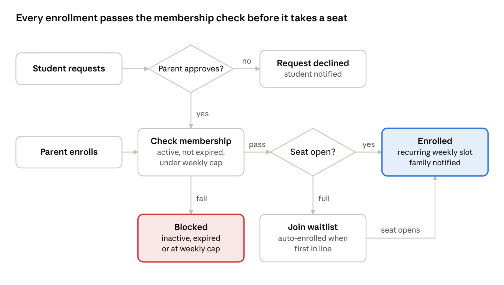

# ELITE Spaces App — PRD (v1)

Oct 6, 2026  · Status: Draft

## Overview

The ELITE Spaces app is the operating system for ELITE Spaces: it checks students in and out, books their study sessions, and keeps parents informed, across a network of Elite Prep / Elite Educational Institute locations in North America.

The concept. ELITE Spaces turns existing Elite Prep brick-and-mortar locations into learning resource centers for homeschooled middle and high school students (ages 13+). Students bring their own curriculum, online or in books, and get a safe, supervised place to study, plus access to center resources.

The problem. Running this across many branches without a dedicated tool means paper sign-ins, spreadsheet schedules, and parents who can't see whether their child arrived or how the day went. Directors have no consistent way to manage capacity or reach families.

Session philosophy. ELITE Spaces is built for short, efficient study windows, not full-day drop-off. Each session runs 2–3 hours, and a typical student attends 3–4 sessions a week. The app should reinforce this: sessions have clear start and end times, enrollment is capped by membership, and attendance is tracked per session.

v1 in one line. Self-scan QR check-in/out, recurring session enrollment with capacity and waitlists, location and network announcements with emergency alerts, daily staff notes for parents, and exportable attendance and hours logs.

## Goals, non-goals and success metrics

v1 succeeds if a dozen pilot locations can run day-to-day operations entirely in the app, with no paper sign-ins or spreadsheet schedules.

Goals

Give every location an accurate, real-time record of who is in the building.

Let parents enroll in recurring sessions themselves, within their membership limits and the branch's capacity.

Keep parents informed daily (arrival, departure, a short staff note) without extra work for staff.

Give directors and HQ one channel for routine announcements and emergency alerts.

Produce attendance and hours records that homeschool families can use for their own record-keeping.

Non-goals for v1

Payments, invoicing or billing of any kind (handled in an external system).

Tutor, lab or resource booking (planned for v2).

Room reservations for outside co-op groups.

Authorized pickup lists or guardian verification at checkout.

Shared kiosk or front-desk check-in devices.

One-off (single-date) enrollment; v1 is recurring only.

Languages other than English.

Native iOS and Android apps (v1 is a mobile-friendly web app).

Success metrics (pilot)

| Metric | Target |
|---|---|
| Visits recorded through QR check-in, not manual staff entry | 90%+ |
| Auto-checkouts (student forgot to scan out) | Under 10% of visits |
| Active families enrolling without staff help | 80%+ |
| Sessions with a daily note posted by end of day | 90%+ |
| Pilot locations running fully on the app | 12 of 12 |

Targets are proposed starting points to confirm before the pilot.

## Users and roles

Five roles, scoped by location: students and parents belong to a home location, staff and directors manage one location, and HQ admins see the whole network.

| Role | Who | Primary jobs | Scope |
|---|---|---|---|
| Student | Homeschooled middle or high schooler, 13+, with their own phone | Scan in and out, view schedule, request sessions, read announcements | Own account |
| Parent / guardian | Account holder for one or more students | Enroll in sessions, approve student requests, see check-in/out times, read daily notes, export hours | Own linked students |
| Location staff | Front desk and floor staff at a branch | Monitor who is in the building, write daily notes, update membership status, fix check-in records | One location |
| Branch director | Leads a branch | Everything staff can do, plus build the session schedule, set capacity, post announcements and emergency alerts, manage staff accounts | One location |
| HQ admin | Elite headquarters operations | Create locations, assign directors, post network-wide announcements and alerts, view cross-location reports | All locations |

Account linking. A parent creates the family account and invites each student by email or phone. One parent account can hold several students. A student can have more than one linked parent (for example, two guardians), and each sees the same records.

Permissions principle. Each role inherits the one below it within its scope (director > staff), and nobody sees another family's data except staff at that family's location and HQ.

## Functional requirements

Seven modules make up v1. Requirement IDs (CI-1, EN-1 and so on) are for tracking in design and engineering.

### 1. Check-in and check-out

CI-1 Each location displays a QR code at its entrance. The code rotates daily at a set time, and yesterday's code stops working.

CI-2 Students check in by opening the app and scanning the code. The app also checks the phone's location and rejects scans from outside the building's radius.

CI-3 Check-in links the visit to the student's enrolled session for that time slot. A student with no enrollment at that time gets a clear message and cannot check in (staff can override; see CI-7).

CI-4 Students check out by scanning the same code.

CI-5 If a student hasn't checked out by the end of their enrolled session or the location's closing time, whichever comes first, the system checks them out automatically and flags the visit for staff review.

CI-6 Parents get a push notification at each check-in and check-out, including auto-checkouts (labeled as such).

CI-7 Staff can view a live "in the building" list and manually check a student in or out (for example, a dead phone). Manual entries are logged with the staff member's name.

### 2. Sessions and scheduling

SC-1 Directors create sessions: open study blocks of 2–3 hours on set days and times (for example, Mon/Wed/Fri 1–4pm).

SC-2 Each session has a capacity based on the facility's total study space. Inside the building, students choose their own spot (rooms, library, open study areas); the app does not assign seats.

SC-3 Directors set terms (start and end dates) and holiday closures. Closures cancel affected sessions and notify enrolled families.

SC-4 Directors can edit or cancel a session; enrolled families are notified automatically.

### 3. Enrollment and waitlists

EN-1 Enrollment is recurring only: a family enrolls in a weekly slot for the rest of the term.

EN-2 Parents can enroll their students directly.

EN-3 Students can request a session. The request goes to their parent(s) to approve or decline, and the student is notified of the result.

EN-4 Enrollment is blocked if the membership is inactive or expired, or if it would exceed the membership's weekly session cap (hard cap).

EN-5 When a session is full, families can join a waitlist. When a seat opens, the first eligible family on the list is enrolled automatically and notified.

EN-6 Parents can drop a recurring enrollment at any time, freeing the seat for the waitlist.

EN-7 No cancellation cutoffs or no-show penalties. A missed session is simply recorded as absent.

### 4. Membership status

MB-1 Each student has a membership record: status (active / inactive), weekly session cap (for example, 3 or 4 per week), start date, and expiration date.

MB-2 Location staff enter and update membership records manually. The app holds no payment data.

MB-3 Parents and students can see the membership status, cap and expiration date.

MB-4 Parents get a reminder before the membership expires (proposed: 14 and 3 days before).

MB-5 On expiration or deactivation, future enrollments are paused, not deleted, so they can be restored if the membership is renewed.

### 5. Announcements and emergency alerts

AN-1 Directors post announcements to their location: events, workshops, holidays, session offerings and general news.

AN-2 HQ admins post network-wide announcements to all locations or a chosen set.

AN-3 Announcements go out as push notifications and stay in an in-app feed. Posts can be scheduled ahead of time.

AN-4 Audience targeting: all families, parents only, students only, or families enrolled in a specific session.

AN-5 Emergency alerts are a separate, high-priority type: they are visually distinct, cannot be muted, and go to everyone at the affected location(s). Directors (own location) and HQ (any) can send them.

AN-6 Senders can see delivery and read counts.

### 6. Daily notes

DN-1 Staff complete a short daily note for each student who attended that day.

DN-2 The note has a quick rating checklist with the same items at every location: On time, Focused, Respectful of others / not distracting, Productive use of time. Each is rated on a simple 3-point scale. HQ can edit the checklist items.

DN-3 The note has an optional freeform comment.

DN-4 Staff can complete notes quickly from the day's attendance list, with ratings defaulting to blank until set.

DN-5 Parents get a notification when a note is posted and can browse past notes by date. Students do not see notes in v1 (see Open questions).

### 7. Attendance and hours export

AT-1 Every visit records check-in time, check-out time, total time, the session, and how check-out happened (scan, auto, staff).

AT-2 Parents can view attendance history by week, month or term.

AT-3 Parents can export an attendance and hours log for a chosen date range as PDF or CSV, suitable for homeschool record-keeping.

AT-4 Directors and HQ can view and export attendance reports by location, session and date range.

## Key user flows

Two flows carry most of v1: enrolling in a session, and a student's visit on the day.

Enrollment

enrollment flow · 2 entry points, 3 checks

A student request needs a parent's approval first; after that, both paths run the same membership and capacity checks.

A typical visit

The student arrives and scans the entrance QR code in the app; the location check passes.

The app matches the scan to their enrolled session and records the check-in. The parent gets a notification.

The student picks a spot (room, library or open study area) and works on their curriculum.

At the end of the session, the student scans out. If they forget, the system checks them out at the session end or closing time and flags it for staff.

Staff complete the daily note (checklist plus optional comment). The parent gets a notification and can read it in the app.

The visit is added to the student's attendance and hours log, ready to export.

## Platform and non-functional requirements

v1 ships as a single responsive web app, installable on phones, with native iOS and Android apps to follow once the pilot proves the workflows.

Platform

Mobile-first web app (installable as a progressive web app) for students and parents: QR scanning through the phone camera, location check, and push notifications.

The same app, laid out for desktop, serves staff, directors and HQ, who do scheduling, notes and reports on larger screens.

Supported browsers: current Safari (iOS) and Chrome (Android and desktop). Note: iOS web push requires the app to be added to the home screen, so onboarding must walk families through this.

Performance and reliability

A check-in scan completes in under 2 seconds on a normal mobile connection.

Waitlist promotion and auto-checkout run reliably on schedule, with no double-booking when two families take the last seat at once.

Each location runs on its own time zone for sessions, closing times and QR rotation.

Privacy and safety

All users are 13 or older, but students are minors: a parent creates the account and approves the student link before the student can use the app.

Location is checked only at the moment of a scan, never tracked in the background.

Families see only their own data. Staff see only their location's families. All staff edits (manual check-ins, membership changes) are logged.

Data encrypted in transit and at rest. Legal review of privacy practices (for example, COPPA, FERPA where relevant, and Canadian privacy law for any Canadian locations) before launch.

Language and accessibility

English only in v1.

Meets WCAG 2.1 AA for contrast, text size and screen-reader labels.

## Rollout, future releases and open questions

v1 pilots at a minimum of 12 locations, with no fixed launch date yet.

Proposed rollout

Build and internal test at one location with staff acting as families.

Soft launch at 2–3 locations with real families, to tune check-in, auto-checkout and notes.

Full pilot at all 12+ locations; HQ reviews metrics monthly.

Decide on v2 based on pilot results.

Planned for v2 and later

Tutor and lab booking (with its own capacity and scheduling)

Native iOS and Android apps

One-off (single-date) enrollment

Integration with the external billing system, so membership status updates automatically

Additional languages

Possibly: student view of daily notes, cross-location attendance for students who visit more than one branch

Open questions

☐ Can a student enroll at more than one location, or only their home location?

☐ Should students see their own daily notes, or are notes parent-only?

☐ Does the weekly session cap reset on a fixed day (for example, Monday), and how does it count a recurring slot that falls on a holiday?

☐ Should staff be able to add capacity for a single day (for example, a busy exam week)?

☐ Who at each location sets QR rotation time and the geofence radius, or is that an HQ setting?

☐ Do Canadian locations need anything different (privacy law, French-language requirements in Quebec)?

☐ Build approach and budget: in-house, agency, or a no-code / AI app builder for the pilot?

☐ Confirm the daily note checklist items and the 3-point scale wording.

☐ Confirm the pilot success metric targets.
